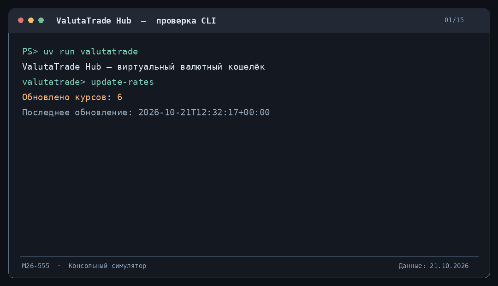

# ValutaTrade Hub

Итоговый проект по Python.  
**Кислощаев, группа М26-555**

Консольное приложение для работы с виртуальным валютным кошельком. Можно зарегистрироваться, пополнить учебный счёт, купить или продать валюту и посмотреть стоимость своего портфеля. Курсы получаются из CoinGecko и ExchangeRate-API.

Реальные деньги здесь не используются: все операции выполняются внутри программы.

## Запуск

Нужны Python 3.11+ и [uv](https://docs.astral.sh/uv/getting-started/installation/).

Откройте терминал в папке проекта, где находится `pyproject.toml`, и выполните:

```bash
uv sync --group dev
uv run valutatrade
```

Можно также запустить `uv run python main.py`.

После запуска появится приглашение `valutatrade>`. В него вводятся команды кошелька. Команды `uv` и `git` нужно вводить в обычном терминале, не внутри приложения.

## Демонстрация



Анимация показывает получение курсов, работу с кошельком и обработку ошибок. Она собрана из вывода консоли; это не видеозапись экрана.

## Команды

| Команда | Что делает |
| --- | --- |
| `register --username alex --password 1234` | Создать пользователя |
| `login --username alex --password 1234` | Войти в профиль |
| `logout` | Выйти из профиля |
| `deposit-demo --amount 10000` | Начислить 10 000 виртуальных USD |
| `buy --currency BTC --amount 0.05` | Купить 0.05 BTC за USD |
| `sell --currency BTC --amount 0.01` | Продать 0.01 BTC за USD |
| `show-portfolio` | Посмотреть балансы и стоимость в USD |
| `show-portfolio --base EUR` | Оценить портфель в EUR |
| `get-rate --from BTC --to USD` | Посмотреть курс и время обновления |
| `update-rates` | Загрузить курсы из API |
| `update-rates --source coingecko` | Обновить только криптовалюты |
| `show-rates` | Показать таблицу сохранённых курсов |
| `show-rates --currency BTC` | Показать только BTC |
| `show-rates --top 2` | Две самые дорогие криптовалюты в кеше |
| `show-rates --base EUR` | Показать курсы относительно EUR |
| `demo-rates` | Записать учебные курсы для проверки без сети |
| `scheduler --interval 300` | Запускать обновление каждые 300 секунд (остановка Ctrl+C) |
| `history` | История операций пользователя |
| `currencies` | Поддерживаемые валюты |
| `help` | Список доступных команд |
| `exit` | Закрыть программу |

Для `buy`, `sell`, `history` и просмотра портфеля нужно сначала выполнить `login`. После перезапуска приложения вход выполняется заново, а кошельки и история остаются в JSON-файлах.

### Пример работы

Команды ниже вводятся **внутри приложения**, по одной:

```text
register --username alex --password 1234
login --username alex --password 1234
deposit-demo --amount 10000
buy --currency BTC --amount 0.05
show-portfolio
sell --currency BTC --amount 0.01
history
exit
```

При повторном запуске пользователь уже существует, поэтому достаточно `login`.

При покупке программа списывает стоимость с USD-кошелька и добавляет купленную валюту. При продаже валюта списывается, а USD начисляются обратно. Чтобы показать эти операции без реального пополнения, добавлена команда `deposit-demo`.

## Курсы валют

Приложение использует два источника:

- **CoinGecko** — BTC, ETH и SOL;
- **ExchangeRate-API** — EUR, GBP и RUB.

Для второго API нужен ключ. Его можно получить на [exchangerate-api.com](https://www.exchangerate-api.com/).

В **PowerShell** перед запуском укажите ключ через переменную окружения:

```powershell
$env:EXCHANGERATE_API_KEY="ваш_ключ"
uv run valutatrade
```

В Linux или WSL:

```bash
export EXCHANGERATE_API_KEY="ваш_ключ"
uv run valutatrade
```

Затем внутри приложения:

```text
update-rates
show-rates
get-rate --from EUR --to USD
get-rate --from BTC --to USD
```

Ключ хранится только в переменной окружения и не добавляется в репозиторий. При недоступности одного API второй продолжает работать; ошибка выводится отдельно.

Если нужно проверить приложение без сети, используйте `demo-rates`. Эта команда создаёт учебные курсы, которые не являются актуальными рыночными значениями.

Последние значения сохраняются в `data/rates.json`, а история обновлений — в `data/exchange_rates.json`. Срок актуальности кеша — **300 секунд** (настраивается в `pyproject.toml`). Для обратного курса используется `1 / rate`, для других пар пересчёт идёт через USD.

## Структура проекта

```text
data/
    users.json                 пользователи
    portfolios.json            кошельки и операции
    rates.json                 последние курсы
    exchange_rates.json        история обновлений
valutatrade_hub/
    core/
        currencies.py          классы валют и их реестр
        models.py              User, Wallet, Portfolio
        usecases.py            регистрация, торговля, курсы
        exceptions.py          ошибки приложения
        utils.py               проверки входных данных
    infra/
        database.py            чтение и сохранение JSON
        settings.py            настройки приложения
    parser_service/
        api_clients.py         клиенты CoinGecko и ExchangeRate-API
        config.py              параметры API
        updater.py             обновление курсов
        storage.py             кеш и история
        scheduler.py           обновление по интервалу
    cli/
        interface.py           обработка консольных команд
    decorators.py              логирование операций
    logging_config.py          настройки логов
docs/
    valutatrade_demo.gif       демонстрация
main.py                        запуск приложения
pyproject.toml                 зависимости и настройки
uv.lock                        зафиксированные версии зависимостей
README.md
.gitignore
```

Основная логика находится в `core/`. Консольный интерфейс разбирает команды и выводит результаты. `parser_service/` получает курсы, а `infra/` отвечает за настройки и хранение данных.

В моделях используются классы, наследование, свойства и проверки значений. `SettingsLoader` и `DatabaseManager` реализованы как Singleton. Операции `buy` и `sell` логируются через декоратор `@log_action`, ошибки обрабатываются через собственные исключения.

Файлы JSON сохраняются через временный файл с последующим переименованием. Логи записываются в `logs/actions.log` с ротацией.

## Проверка перед сдачей

Команды нужно выполнять в терминале из корня проекта:

```bash
uv sync --group dev
uv run ruff check .
uv run ruff format --check .
uv build
```

Проверки Ruff и сборка пакета успешно выполнялись на Windows с Python 3.12. Команды `update-rates`, `buy`, `sell`, `show-portfolio`, `get-rate` и обработка ошибок также проверены вручную. Для реальных запросов использовались оба API.

Дополнительно можно проверить ошибки:

```text
sell --currency BTC --amount 100
buy --currency BTC --amount -1
get-rate --from ABC --to USD
```

Программа должна объяснить ошибку и продолжить работу.

## Примечания

- Балансы и сделки учебные; комиссий биржи нет.
- Для учебного задания пароль хранится как хеш SHA-256 с индивидуальной солью. Для реального приложения потребовался бы более стойкий алгоритм, например Argon2.
- Данные сохраняются в JSON, поэтому приложение рассчитано на локальную работу одного процесса, а не одновременную торговлю нескольких пользователей.
